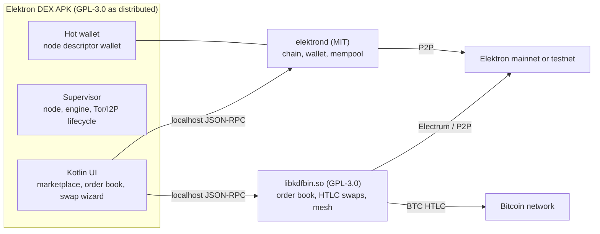

# Elektron DEX: license, architecture and milestones

- **Version:** 0.2 (draft)
- **Date:** November 14, 2026
- **Audience:** maintainers, Android/Kotlin developers, release engineers, legal reviewers
- **Repository:** `elektron-net-mobiledex`, default branch `dex`, fork of [`kutlusoy/elektron-net-mobiledex`](https://github.com/kutlusoy/elektron-net-mobiledex)
- **Related:** [`README.md`](../README.md) (app description), [`WHITEPAPER.md`](../WHITEPAPER.md), [`guideline-mobile-fullnode-wallet-plan.md`](./guideline-mobile-fullnode-wallet-plan.md), [`guideline-distribution-and-signing.md`](./guideline-distribution-and-signing.md), [`NOTICE-komodo-defi-framework.md`](./NOTICE-komodo-defi-framework.md), [`notice-gleec-distribution.md`](./notice-gleec-distribution.md), [`concept-clean-room-swap.md`](./concept-clean-room-swap.md)
- **Status:** proposal. Nothing here is legal advice; §10 lists what a lawyer has to confirm before the first public release.

Requirement levels: **MUST** = mandatory for a correct or compliant result, **SHOULD** = strongly recommended, **MAY** = optional.

---

## 1. Decisions

| Date | Decision | Basis |
|---|---|---|
| 2026-11-13 | The atomic-swap marketplace is a separate app line, not part of the MIT wallet | Review of Ali Kutlusoy: license separation, marketplace focus, hot wallet |
| 2026-11-14 | The app line is **GPL-3.0** for everything it adds on top of the inherited wallet code | License facts in §2, user decision |
| 2026-11-14 | Own application ID `org.elektronnet.mobiledex` (testnet `org.elektronnet.mobiledextestnet`), app name **Elektron DEX** | Already set in `app/build.gradle.kts` |
| 2026-11-14 | **No Elektron Net fee** on swaps for now. The `Dex_Fee`/`license protected` sections of the swap engine stay untouched | User decision; see §4 |
| 2026-11-14 | A **clean-room** implementation of the swap protocol runs in parallel, not as a blocker | User decision; see [`concept-clean-room-swap.md`](./concept-clean-room-swap.md) |
| 2026-11-14 | Development happens on a personal fork, changes reach the upstream repository through pull requests | This document |

## 2. Verified license facts

Checked in a local checkout on November 14, 2026. Paths are the evidence.

| Component | Evidence | License | Consequence |
|---|---|---|---|
| Inherited wallet code | `LICENSE` in this repository, `README.md` §12 | MIT, "Copyright (c) 2026 Elektron Net Developers, Ali Kutlusoy (@kutlusoy), Milio aka 1000io (@spiroflex)" | Stays MIT. MIT permits inclusion in a GPL-3.0 work as long as the notice is kept. |
| `elektron-net-electrs` | `elektron-net-electrs/Cargo.toml`, `license = "MIT"` | MIT | Separate process, no conflict. |
| Komodo DeFi Framework (KDF) | Local checkout `artifacts/komodo-defi-framework`, upstream `GLEECBTC/komodo-defi-framework`, commit `367e4dd4d`; `LEGAL/COPYING` is the GNU GPL v3, 29 June 2007 | **GPL-3.0** | Distributing an APK that contains the engine puts the whole APK under GPL-3.0. |
| KDF copyright notice | `LEGAL/LICENSE-COPYRIGHT-NOTICE`, copied verbatim to [`NOTICE-komodo-defi-framework.md`](./NOTICE-komodo-defi-framework.md) | Additional terms on top of GPL-3.0 | Conditions in §4 apply to a modified work. |
| Bundled engine | `libkdfbin.so` (arm64) built from the commit above, later to be added to this tree | inherits KDF | The APK, not only the source, carries the obligation. |

## 3. Correction to the AGPLv3 passage

The review message quotes an AGPLv3 paragraph about offering modified software over a network and concludes that the wallet would have to be AGPLv3. Against the local copy that is not correct, and the difference matters:

- The bundled license text is **GPL-3.0**. It has no network clause; obligations start at **distribution** of a binary, not at offering a service.
- The quoted text is **AGPLv3 §13**. GPL-3.0 ends at §17.
- The conclusion of the review still holds for a different reason: an APK that contains GPL-3.0 code is a **combined work**, so the distributed binary is conveyed under GPL-3.0. Keeping the wallet and the DEX line apart keeps each line's distribution clean.

## 4. Conditions from Gleec Holding OÜ

The notice in [`NOTICE-komodo-defi-framework.md`](./NOTICE-komodo-defi-framework.md) allows distributing a modified work under GPL-3.0 only if:

- **(a)** separately posted copies clearly acknowledge that they contain material copyrighted by Gleec Holding OÜ,
- **(b)** **no charge is associated with such copies**,
- **(c)** Gleec Holding OÜ is notified of the distribution,
- **(d)** secondary users are clearly told that the modified work is not the original software,
- **(e)/(f)** sections marked "license protected" or `Dex_Fee`/`DEX_FEE`, and the listed files in `common.rs`, `z_coin.rs` and `lp_swap.rs`, are **not modified**.

Consequences for this app:

1. Distribution MUST be free of charge unless a separate written agreement exists. A paid listing, a paid unlock of the swap feature, or any in-app purchase around it needs that agreement first.
2. **No Elektron Net fee** is taken on swaps (decision of November 14, 2026). If that changes, the fee MUST live outside the protected code or be agreed with Gleec in writing.
3. The upstream notification MUST be sent before the first public artifact, and the date recorded in [`notice-gleec-distribution.md`](./notice-gleec-distribution.md).
4. An "About" screen MUST carry the notice and a link to the corresponding source of the exact build.
5. Patches against the engine MUST be avoided where possible; a patch MUST NOT touch the protected sections.

## 5. License model of this repository

Three layers, one APK:

| Layer | Files | License |
|---|---|---|
| Inherited wallet code | everything that came from `elektron-net-mobile` at `4a93435` | MIT, notice kept in `LICENSE` |
| DEX additions | swap client, KDF bridge, marketplace UI, build glue added in this line | **GPL-3.0** |
| Third-party engine | `libkdfbin.so`, built from KDF `367e4dd4d` | GPL-3.0 plus the Gleec notice |

The **distributed APK is GPL-3.0 as a whole**. A recipient receives GPL-3.0 rights for the binary, the complete corresponding source of the build, and the MIT notice for the inherited parts. The inherited source remains available under MIT; nothing here relicenses upstream code for anyone else.

Every new source file in this line MUST carry an SPDX header: `// SPDX-License-Identifier: GPL-3.0-only` (Kotlin), `# SPDX-License-Identifier: GPL-3.0-only` (shell, Python). Files that are edited from the inherited tree keep their MIT header and gain the GPL-3.0 line only when the file becomes a DEX file; if in doubt, ask before adding.

## 6. Architecture

### 6.1 Process model

The app supervises three processes and keeps the engine at arm's length behind its JSON-RPC interface. This is a maintenance and review boundary, not a legal guarantee on its own (§11, Q4).

### 6.2 Module split

| Module | License | Contents | Source |
|---|---|---|---|
| node, wallet, privacy | MIT | node control, descriptor wallets, receive/send/PSBT, pruning, compact receipts | already in this tree |
| swap bridge | **GPL-3.0** | `KdfClient`, `KdfConfig`, `KdfSupervisor`, `SwapPruner` wiring | port from `elektron-net-mobile` branch `feat/kdf-swap-integration` |
| swap UI | **GPL-3.0** | `SwapScreen`, order book view, swap wizard, history | port as above, then rebuild for a marketplace layout |
| engine | GPL-3.0 | `libkdfbin.so` | built from KDF `367e4dd4d`, never patched in protected sections |

What must not happen: the engine's code is never linked into the Kotlin/Java code, and no module of this app is published as MIT while it contains swap code.

### 6.3 Hot wallet guardrails

The DEX wallet is a hot wallet by design; the marketplace must be usable without a hardware signer.

- **Separate seed.** MUST NOT reuse the seed of the wallet in `elektron-net-mobile`.
- **Capped float.** A per-swap and a per-day cap, enforced in the swap path, not only in the UI.
- **Withdrawal to cold.** Moving funds out goes to a stored address from the wallet app, gated by **BIOMETRIC_STRONG** and a confirmation that shows address, amount and fee.
- **No cloud backup.** The seed is shown once, `FLAG_SECURE`, never exported in plain text.
- **Fast signing for swaps.** No biometric on every swap step; the float is the risk budget.
- **Pruned receipts.** No raw hex dumps, no counterparty addresses after the swap ends.

The app lock stays biometry-first: a PIN or pattern is only the fallback for phones without a sensor.

## 7. Marketplace surface (MVP)

1. **Market**: pair selector (`ELEK/BTC`, later `ELEK/USDT`), order book with cumulative depth, VWAP over depth, best bid/ask, spread.
2. **My orders**: open maker orders, cancel, fill progress, energy-floor preset (`0.54 sat/ELEK`) with the 546 sat dust guard.
3. **Swap**: maker and taker wizard with the swap stages as a progress list, timeouts and failure reasons, "claim to wallet" when finished.
4. **History**: pruned receipts, realized VWAP per pair, CSV export without addresses.
5. **Status**: engine mesh, peers, seednodes, Electrum endpoints, version.

## 8. Milestones

| ID | Milestone | Acceptance | Falsifier |
|---|---|---|---|
| M0 | License and repository skeleton | `LICENSE-GPL-3.0`, `NOTICE-komodo-defi-framework.md`, this document, README pointer, SPDX rule | A release without a source link or without the notices |
| M1 | Port the swap layer | the DEX app builds and runs a testnet swap between two phones; no protected engine section is patched | `git diff` touches a `Dex_Fee` section, or the swap fails |
| M2 | Marketplace UI | order book, own orders, wizard and pruned history work on a J5-class device without ANR | a screen blocks on a network call |
| M3 | Hot-wallet guardrails | caps enforced in the swap path, withdrawal gated by a strong biometric, caps unit tested | a swap above the cap succeeds |
| M4 | Release pipeline | own signing key, GPL source archive per release, Gleec notification recorded | an artifact without corresponding source |

M1 is the next step and only needs the branch that already exists in the wallet repository.

## 9. Fork workflow

- `origin` is the personal fork `bartman081523/elektron-net-mobiledex`, `upstream` is `kutlusoy/elektron-net-mobiledex`. Work happens on topic branches, `dex` stays close to upstream.
- Changes reach the upstream repository through pull requests. The maintainer decides what lands.
- There is no regular merge with `elektron-net-mobile`. A fix useful in both lines is cherry-picked into each repository on its own.
- Releases are built and signed by this line with its own key; the wallet key MUST NOT be reused.
- Every release publishes the complete corresponding source of the exact build (tag plus archive) and `SHA256SUMS.txt`.

## 10. Open questions

| # | Question | Why it matters |
|---|---|---|
| Q1 | Who holds the release signing key for this line? | GPL source offer and update path depend on a stable key |
| Q2 | Is any paid distribution planned? | Gleec condition (b): no charge without a separate agreement |
| Q3 | Does a lawyer accept the process boundary as separation between the MIT wallet and the GPL-3.0 DEX? | If not, only the clean-room line removes the question |
| Q4 | Who implements the clean-room line, given that the current contributors have read the engine source? | A clean room needs an implementer who has not; see the clean-room document |
| Q5 | Which public channels may be used for the Gleec notification? | Condition (c) needs a provable delivery |
